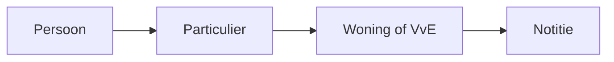

# Tribe Energieloket

Inwoners en VvE's melden zich met een formulier aan voor een adviesgesprek bij het Energieloket. Die aanmeldingen komen in de Tribe-omgeving van het Energieloket. De inzending volgt dezelfde weg als bij Autodelen, tot en met de Tribe-lambda ([Tribe-koppeling](README.md)). De lambda maakt de records in Tribe zelf aan, stap voor stap.

Bij een inwoner krijgt de persoon ook een Adres. De Particulier is de rol waarmee een persoon aan een Woning of VvE hangt. Een inzending heeft daarvoor tussen de 6 en 12 aanroepen naar Tribe nodig. Elke stap staat met Tribe-ID in de logs.

## Wat er in Tribe komt

| | Inwoner | VvE |
|---|---|---|
| Persoon | naam, e-mail, telefoon, met adres | naam, e-mail, telefoon |
| Woning of VvE | Woning: adres, woningtype, bouwjaar, gas- en elektriciteitsverbruik, verwarming, gedane verbeteringen en wensen | VvE: naam, aantal adressen, bouwjaar, percentage eigenaar-bewoners, splitsing, MJOP, duurzaamheidscommissie, verbeteringen |
| Notitie | contactvoorkeur | de rest: adressenlijst, soort huizen, huurhuizen, andere functies, de eigen woning van de invuller, bekendheid, huisbezoek, contactvoorkeur |

De volledige mapping per formulierveld komt bij het objecttype.

## Wat er in de code verandert

- De Tribe-lambda krijgt twee verwerkingen erbij: inwoner en VvE.
- Het objecttype TribeVerzoek krijgt een uitgewerkt deel energieloket, waaraan Team Online de formuliervelden koppelt.
- Er komt een tweede secret voor de Tribe-omgeving van het Energieloket.
- Elke aanroep naar Tribe wordt gelogd met OF-nummer, object-UUID, stap, Tribe-ID en duur. Formulierinhoud staat niet in de logs van productie.

Autodelen blijft zoals het is. Wat er per PR wordt opgeleverd, staat in de [README bij de code](../../src/submission-forwarder/tribe/README.md).

## Keuzes

- Een antwoord dat niet in een Tribe-keuzelijst past, gaat als tekst mee. Een nieuwe optie in het formulier houdt dus geen inzending tegen.
- Elke inzending maakt een nieuwe persoon aan. Het loket voegt dubbelen samen in Tribe.
- Er is één Tribe-omgeving. Inzendingen vanaf acceptatie komen daar ook in, met TEST ACCEPTATIE bovenaan de notitie.
- Bijlagen worden nog niet meegestuurd. Dat kan aan het einde.
