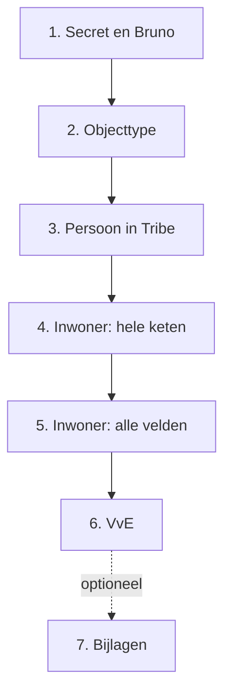

# Tribe

De TribeProcessor-lambda stuurt inzendingen uit Open Formulieren naar Tribe. Per Tribe-omgeving en type aanmelding kiest hij een processor, die met een eigen client en secret de Tribe-aanroepen doet. Hoe een inzending hier komt, hoe dry-run en foutafhandeling werken en hoe je een nieuw type toevoegt, staat in de [Tribe-docs](../../../docs/Tribe/README.md).

Autodelen werkt nu: één aanroep naar een formulier in Tribe. Hier komt het Energieloket bij, met twee formulieren (inwoner en VvE) die in meerdere stappen records in Tribe aanmaken. Wat er in Tribe komt, staat in [Energieloket](../../../docs/Tribe/Energieloket.md).

## Wat we opleveren

Het Energieloket komt er in een paar PR's. Elke PR begint met de docs, daarna de code. Hieronder staat per PR wat er samen wordt opgeleverd.

## 1. Secret en Bruno

Deze PR. De lambda doet nog niets anders.

- Docs: wat het Energieloket in Tribe doet, en dit overzicht.
- Bruno: de Tribe-omgeving van het Energieloket met auth, een healthcheck en de keuzelijsten.
- Een tweede secret voor de Tribe-omgeving van het Energieloket, dat de lambda mag lezen.
- De code van Autodelen in een eigen map, autodelen. Alleen verplaatst, het gedrag blijft gelijk. Het Energieloket komt in de map energieloket ernaast.

## 2. Objecttype

- Het deel energieloket in TribeVerzoek, met per veld welk formulierveld erbij hoort en waar het in Tribe komt.
- Het Zod-schema, met een voorbeeldobject per formulier.
- De mapping per formulierveld in de docs, zodat Team Online de formulieren kan koppelen.
- Bruno-requests met werkende payloads om records te koppelen, op te zoeken en een notitie toe te voegen.
- Bruno-requests die laten zien hoe een record van dezelfde inzending in Tribe terug te vinden is.

## 3. Persoon in Tribe

De eerste echte aanroep naar Tribe.

- De lambda leest het secret van het Energieloket en kent de verwerking van het inwonerformulier.
- De verwerking maakt een Persoon aan met naam, e-mail en telefoon.
- Elke aanroep naar Tribe staat in de logs met OF-nummer, objectUuid, stap, Tribe-ID en duur.
- Dezelfde inzending opnieuw verwerken maakt geen tweede persoon. Is de uitkomst van een aanroep onzeker, dan stopt de verwerking. Een nieuwe aanmelding van dezelfde persoon geeft wel een nieuwe persoon.
- Acceptatie stuurt inzendingen echt naar Tribe, ook die van Autodelen.

## 4. Inwoner: hele keten

- Particulier: de rol waarmee de persoon aan de woning hangt.
- De Woning met de adresvelden.
- Een notitie op de woning, op acceptatie met TEST ACCEPTATIE bovenaan.
- Ook deze stappen maken bij opnieuw verwerken geen dubbele records.

## 5. Inwoner: alle velden

- Alle velden van het inwonerformulier, met het Adres van de persoon en de keuzelijsten.
- Een antwoord dat niet in een Tribe-keuzelijst past, gaat als tekst mee.
- Per scenario een voorbeeldinzending met de verwachte Tribe-aanroepen als test.

## 6. VvE

- De verwerking van het VvE-formulier: Persoon, Particulier en VvE.
- Een notitie op de VvE met alles wat geen eigen veld in Tribe heeft.
- Per scenario een voorbeeldinzending als test.
- Docs voor beheer: een inzending volgen in de logs en opnieuw verwerken.

Daarna gaan de formulieren live: Team Online koppelt ze aan het objecttype, het loket test op acceptatie, daarna productie. Daar hoort geen eigen PR bij.

## 7. Bijlagen

Als laatste, eerst de inzending goed krijgen.

- De step function geeft de bestanden mee aan de Tribe-stap.
- De pdf en uploads komen als bijlage in Tribe, één aanroep per bestand.
