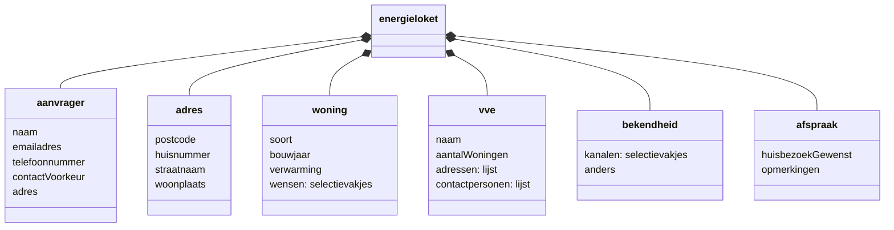
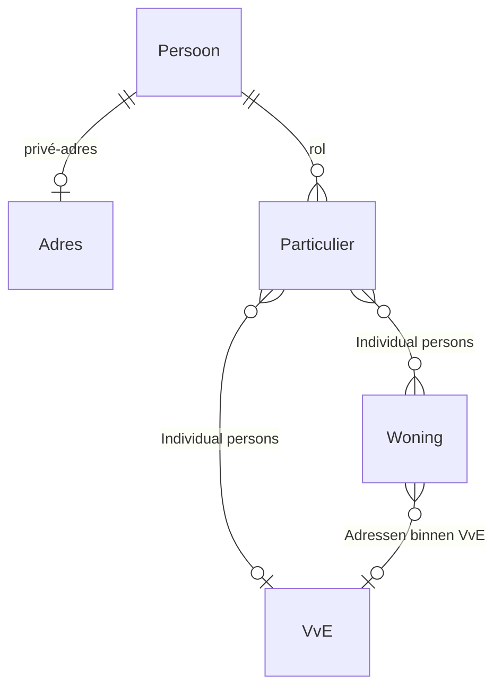
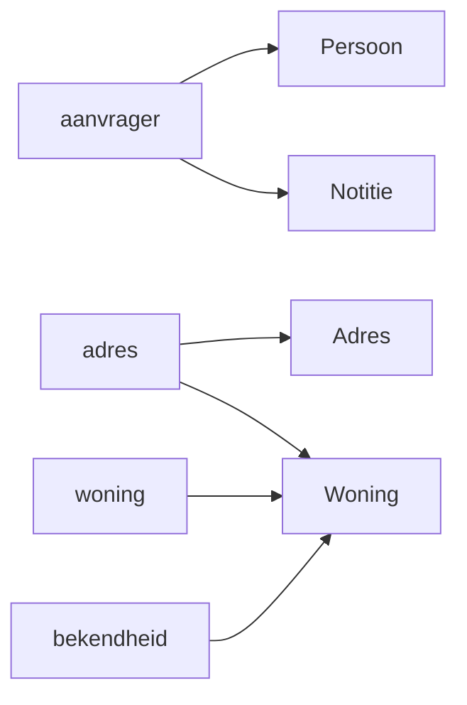
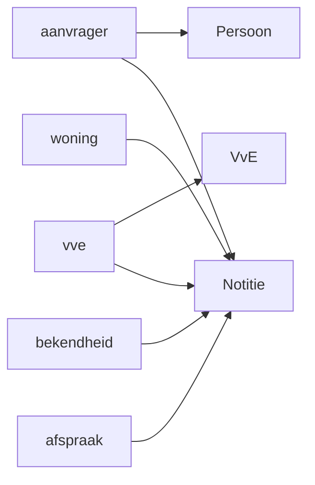

# Datamodel Energieloket

Hoe een aanmelding voor het [Energieloket](../../../../../docs/Tribe/Energieloket.md) eruitziet in het objecttype en in Tribe. Welk formulierveld waar terechtkomt, staat in de [mapping](mapping.md).

## Objecttype

Het deel `energieloket` in TribeVerzoek is in groepen verdeeld. Beide formulieren gebruiken dezelfde groep waar het om hetzelfde gaat. Alle groepen en velden zijn optioneel en mogen leeg zijn, en een onbekend extra veld geeft geen validatiefout. De belangrijkste velden per groep; alle velden staan in de [mapping](mapping.md).

Welk formulier welke groep vult:

| Groep | Wat | Inwoner | VvE |
|---|---|---|---|
| `aanvrager` | De invuller | ja | ja |
| `adres` | Het adres van de woning waarvoor advies wordt gevraagd | ja | |
| `woning` | Inwoner: die woning. VvE: de eigen woning van de invuller | ja | ja |
| `vve` | De vereniging van eigenaars | | ja |
| `bekendheid` | Hoe de invuller van het Energieloket hoorde | ja | ja |
| `afspraak` | Wensen voor het adviesgesprek, zoals een huisbezoek | | ja |

Waar elke groep in Tribe terechtkomt, staat per formulier onder [Van objecttype naar Tribe](#van-objecttype-naar-tribe).

Het objecttype bevat ook velden die de formulieren nog niet vragen, maar waarvoor Tribe een plek heeft, zoals een apart adres van de aanvrager en meer contactpersonen bij een VvE. Zo kan een formulier een vraag toevoegen zonder nieuwe versie van het objecttype. De koppeling gebruikt zo'n veld pas als het formulier het vraagt; de mapping noemt ze onder [Velden voor later](mapping.md#velden-voor-later).

## Records in Tribe

| Record | Wat het is |
|---|---|
| Persoon | De aanvrager, met naam, e-mailadres en telefoonnummer. Tribe maakt de naam zelf uit voornaam, tussenvoegsel en achternaam. |
| Adres | Het privé-adres van de Persoon. Het huisnummer is een getal, de toevoeging een apart veld. |
| Particulier | De rol waarmee de Persoon aan een Woning of VvE hangt. Woning en VvE kennen alleen deze rol, niet de Persoon. Een Particulier hoort bij één VvE. |
| Woning | Eigen entiteit van het Energieloket. Het adres staat in eigen velden op de Woning (Straat, Huisnummer, Huisnummertoevoeging, Postcode, Woonplaats), niet in een gekoppeld Adres; bij het inwonerformulier komen ze uit `adres`, dat het formulier verplicht vraagt. De titel in Tribe is het veld Adres: straat en huisnummer, de toevoeging er zonder spatie achter, zoals Teststraat 1a. |
| VvE | Eigen entiteit van het Energieloket. De titel is Naam VvE. De Woningen van de VvE kunnen eraan hangen als Adressen binnen VvE. |
| Notitie | Eén leesbaar tekstblok op de Woning of VvE met wat geen eigen veld heeft, per regel een vraag en het antwoord. Op acceptatie begint hij met TEST ACCEPTATIE. |

De Particulier ontstaat in dezelfde aanroep als de Persoon en het Adres. Alleen dan vult Tribe de naam van de Particulier en toont hij de persoonsgegevens op de Woning of VvE. Een apart aangemaakte Particulier heet in Tribe "Geen titel".

Adressen binnen VvE blijft leeg. Het formulier vraagt per straat een reeks huisnummers, zoals Bloemenstraat 2-46; daaruit zijn geen betrouwbare losse adressen te halen. De lijst gaat zoals ingevuld in de notitie.

## Van objecttype naar Tribe

Formulier inwoner:

De Persoon krijgt `aanvrager.adres` als privé-adres. Is dat leeg, zoals bij het formulier van nu, dan het adres van de woning.

Formulier VvE:

Bij het VvE-formulier gaat `woning` naar de notitie: het gaat om de eigen woning van de invuller, waarvan het formulier geen adres vraagt. De Persoon krijgt alleen een Adres als `aanvrager.adres` gevuld is.

## Keuzelijsten

Tribe heeft voor een aantal velden een keuzelijst. Waar de opties van het formulier één op één passen, kiest de koppeling de waarde uit de lijst: woningtype, verwarming, gedane verbeteringen en wensen van een woning. In de andere gevallen gaat het antwoord als tekst mee, in het tekstveld ernaast of in de notitie, en stopt de verwerking niet:

- Bekendheid Energieloket en de wensen en verbeteringen van een VvE hebben in Tribe één waarde, terwijl het formulier er meer toestaat.
- Woonplaats kent alleen Nijmegen en Lent.
- Het woningtype van een VvE heeft in Tribe een keuzelijst, maar nog geen veld op de VvE.

Verhouding eigendom van een VvE (alleen koop, alleen huur, mix) volgt uit `vve.verhoudingEigendom`. Is dat leeg, dan uit de vraag naar huurhuizen: nee is alleen koop, ja is mix.
