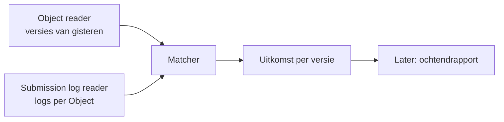
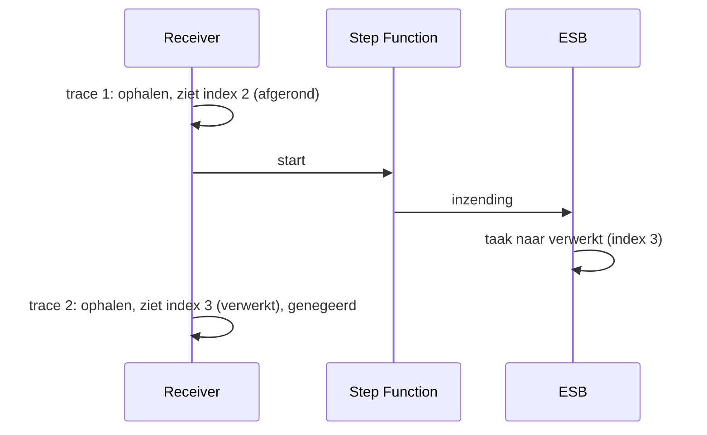
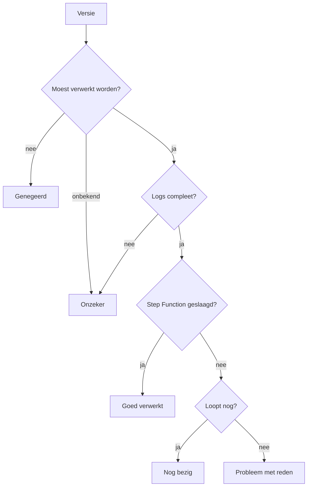

# Matcher

De matcher legt de Object-versies uit de [object reader](../object-reader/README.md) naast de logs uit de
[submission log reader](../submission-log-reader/README.md) en zegt per versie wat ermee gebeurd is. Een versie is één record van een Object:
objectUuid plus index.

De matcher kijkt alleen. Hij haalt zelf niets op, verandert niets in Objects en start niets opnieuw. Dezelfde invoer geeft altijd dezelfde uitkomst.



## Gebruik

Het contract staat in SubmissionProcessingMatcher.ts. findOutcomes gooit nog een fout: de beoordeling is nog niet gebouwd.

```ts
import { SubmissionProcessingMatcher } from './matcher/SubmissionProcessingMatcher';

const matcher = new SubmissionProcessingMatcher();
const outcomes = matcher.findOutcomes({
  versions: await objectReader.findVersions(),
  logs: [await logReader.findByObjectUuid({ objectUuid, range })],
  objectUuidsWithUnreadLogs: [],
});
```

De aanroeper haalt de logs per objectUuid op. Gooit de log reader voor een Object, dan zet de aanroeper die uuid in objectUuidsWithUnreadLogs;
de versies van dat Object worden dan onzeker. Er komt één uitkomst per versie terug (versions) en een lijst traces die bij geen versie horen
(tracesWithoutVersion). In een uitkomst staan de versie zelf, de uitkomst, de reden en de traces waarop hij gebaseerd is.

## Uitkomst per versie

Elke versie krijgt precies één uitkomst.

| Uitkomst | Code | Betekenis |
|---|---|---|
| Goed verwerkt | PROCESSED | Moest verwerkt worden en de Step Function eindigde met ExecutionSucceeded |
| Genegeerd | IGNORED | Hoefde volgens de regels niet verwerkt te worden, zoals een ESF-taak met status open |
| Probleem | PROBLEM | Er is aantoonbaar iets misgegaan |
| Nog bezig | IN_PROGRESS | Wel ExecutionStarted, nog geen eindevent |
| Onzeker | UNCERTAIN | Te weinig gegevens voor een conclusie. Ontbrekend bewijs is geen fout |

Bij PROBLEM en UNCERTAIN staat altijd een reden (zie Beoordeling). Bij elke uitkomst staan de traces waarop hij gebaseerd is, met hun
correlation_id's en execution_arn's, zodat je direct in CloudWatch verder kunt zoeken.

## Moest deze versie verwerkt worden?

Dat bepaalt de matcher eerst, met de status van die versie en niet met de huidige status van het Object. Het is dezelfde regel als in de receiver:

- ESF-taak: alleen bij status afgerond. Bij open, verwerkt en gesloten hoort er geen Step Function te zijn.
- Andere objecttypes uit de config: altijd.
- ESF-taak met een andere of geen status: onzeker. De matcher verzint geen verwachting.

Zo ziet een normale ESF-taak eruit:

| Index | Status | Wat er gebeurt | Uitkomst |
|---|---|---|---|
| 1 | open | taak aangemaakt, receiver negeert hem | Genegeerd |
| 2 | afgerond | inwoner heeft het formulier ingediend, Step Function stuurt door | Goed verwerkt als die slaagt |
| 3 | verwerkt | de ESB heeft de inzending opgepakt, vaak binnen seconden | Genegeerd |

## Welke logs horen bij een versie?

Een trace is één notificatie: alle logregels met dezelfde correlation_id. Een trace hoort bij een versie als de receiver na het ophalen dezelfde
index logde. Traces worden nooit samengevoegd; meerdere traces voor één versie blijven allemaal zichtbaar.

Een notificatie zegt niet over welke index hij gaat. De receiver haalt het Object op en logt de index van het record dat hij op dat moment ziet.
Daarom telt wat de receiver zag, niet welke notificatie het was. Bij een ESF-taak geeft dat normaal twee traces kort na elkaar:



Trace 1 hoort bij versie 2 en trace 2 bij versie 3. Voor de versie met afgerond is de vraag: is er een geslaagde Step Function voor die index?

Een trace zonder index (het ophalen mislukte) koppelt de matcher alleen als het Object maar één versie in de periode heeft. Anders is het onzeker en
staat de trace erbij. Traces met een index die niet in de versies zit, bijvoorbeeld van een versie van vandaag, gooit de matcher niet weg: ze komen
apart in het resultaat.

Open Notificaties stuurt een notificatie niet opnieuw als de receiver een fout geeft. Een mislukte poging herstelt zich dus niet vanzelf. Is er voor
een versie toch ook een geslaagde Step Function, dan is die goed verwerkt en staat de mislukte poging erbij.

## Beoordeling



Bij PROBLEM is de reden de eerste stap die aantoonbaar misging: NO_NOTIFICATION, OBJECT_FETCH_FAILED, OBJECT_PARSE_FAILED,
OBJECT_TYPE_UNKNOWN_AT_RECEIVER (genegeerd terwijl verwerking verwacht werd), EXECUTION_START_FAILED, EXECUTION_NOT_STARTED, EXECUTION_FAILED,
EXECUTION_TIMED_OUT of EXECUTION_ABORTED.

Bij UNCERTAIN: LOGS_NOT_READ (de log reader gooide), LOGS_TIME_RANGE_TOO_SHORT (zie Tijd), TRACE_FITS_MULTIPLE_VERSIONS, UNKNOWN_ESF_STATUS of
EXECUTION_EVENTS_NOT_FOUND (wel een execution_arn, maar geen events van de Step Function).

## Tijd

De Objects API kent per versie alleen een datum, geen tijd. Een versie van 23:59 kan zijn notificatie en Step Function pas na middernacht hebben.
Lees de logs daarom vanaf het begin van de registratiedag tot ruim erna, niet alleen over die dag. De matcher kijkt naar het gelezen tijdvak
(queryRange in het resultaat van de log reader). Is dat te kort, dan is een ontbrekende notificatie geen PROBLEM maar UNCERTAIN met
LOGS_TIME_RANGE_TOO_SHORT.

## Wat de matcher niet doet

- Logs of Objects ophalen: dat doen de readers.
- Iets herstarten, aanpassen of opslaan.
- Een rapport maken of versturen: dat gebruikt later de uitkomsten.
- Beoordelen of een geslaagde Step Function inhoudelijk goed was. Een opgevangen fout binnen een geslaagde Step Function ziet hij niet als probleem.
