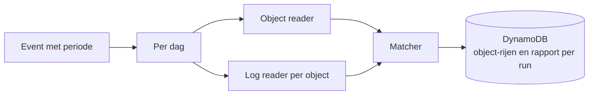

# Processing check

Eén Lambda die voor een periode controleert of de inzendingen verwerkt zijn. Per dag haalt hij de Object-versies op met de
[object reader](../object-reader/README.md), de logs met de [submission log reader](../submission-log-reader/README.md), en laat de
[matcher](../matcher/README.md) per versie de uitkomst bepalen. De uitkomsten slaat hij per inzending op in DynamoDB, en per run legt hij een
rapport vast.

De processing check kijkt alleen. Hij verandert niets aan Objects en start niets opnieuw.



## Aanroepen

Handmatig vanuit de AWS Lambda-console, met een test-event. Beide dagen tellen mee, in Amsterdamse tijd:

```json
{ "firstDay": "2026-11-16", "lastDay": "2026-11-18" }
```

Een leeg event `{}` controleert gisteren. Met maar één van de twee dagen, een datum die niet bestaat of firstDay na lastDay geeft de Lambda een
fout terug en doet hij niets.

Het antwoord is het rapport van de run, met alleen de aantallen. De details staan in DynamoDB.

## Wat een run doet

1. Het rapport van de run wordt aangemaakt met status RUNNING en een nieuwe runId (de request-id van de Lambda).
2. Dan per dag, na elkaar:
   1. De object reader haalt alle versies van die dag op.
   2. Per object haalt de log reader de logs op, van het begin van die dag tot nu. Drie objecten tegelijk.
   3. De matcher bepaalt per versie de uitkomst.
   4. Elke object-rij wordt bijgewerkt, en de dag krijgt in het rapport COMPLETE of INCOMPLETE.
3. Het rapport krijgt de totalen en de status COMPLETE (alle dagen COMPLETE) of INCOMPLETE.

Mislukt dag 3, dan blijven dag 1 en 2 gewoon staan.

## Opslag

Eén tabel, twee soorten rijen:

| PK | SK | Wat |
|---|---|---|
| `OBJECT#<objectUuid>` | `OBJECT` | één inzending, met alle versies die ooit gecontroleerd zijn |
| `RUN` | `<startedAt>#<runId>` | het rapport van één run |

### Object-rij

Eén rij per inzending, over de dagen heen. Een ESF-taak met open op maandag en afgerond op woensdag staat dus in één rij.

```json
{
  "PK": "OBJECT#3f6c2a9e-0b1d-4c55-9a37-2d8e5f1b7c40",
  "SK": "OBJECT",
  "objectUuid": "3f6c2a9e-0b1d-4c55-9a37-2d8e5f1b7c40",
  "objectTypeName": "esfTaak",
  "reference": "OF-TEST01",
  "formName": "Voorbeeldformulier",
  "objectOutcome": "PROBLEM",
  "versions": [
    { "index": 1, "registrationAt": "2026-11-18", "esfStatus": "open", "outcome": "IGNORED" },
    {
      "index": 2, "registrationAt": "2026-11-18", "esfStatus": "afgerond", "outcome": "PROBLEM", "reason": "EXECUTION_FAILED",
      "correlationIds": ["..."], "executionArns": ["arn:aws:states:...:execution:orchestrator:..."]
    }
  ],
  "firstCheckedAt": "2026-11-19T06:00:12Z",
  "lastCheckedAt": "2026-11-19T06:00:12Z",
  "firstProblemAt": "2026-11-19T06:00:12Z",
  "runId": "..."
}
```

- `objectOutcome` is de slechtste uitkomst van de versies: PROBLEM, dan UNCERTAIN, IN_PROGRESS, PROCESSED_AFTER_REDRIVE, PROCESSED, IGNORED.
- `reference` en `formName` komen uit de logs van de receiver, alleen uit traces die zeker bij een versie van dit object horen. Mislukte het
  ophalen van het Object, dan zijn ze onbekend en ontbreken ze. De objectUuid staat er altijd.
- Bij een nieuwe controle van een dag worden alleen de versies van die dag vervangen. Versies van andere dagen blijven staan.
- `firstCheckedAt` wordt één keer gezet. `lastCheckedAt` en `runId` zijn van de laatste controle.
- `firstProblemAt` wordt gezet de eerste keer dat objectOutcome PROBLEM is, en blijft staan. `resolvedAt` wordt gezet als een object met
  firstProblemAt daarna goed is (PROCESSED, PROCESSED_AFTER_REDRIVE of IGNORED), en weer weggehaald als het later opnieuw misgaat.

Er staan geen persoonsgegevens, formulierdata of logregels in de tabel. Met de correlation_id's en execution_arn's zoek je in CloudWatch verder,
zolang de logs bestaan (6 maanden).

## Rapport per run

Elke aanroep is een run met een eigen rapport. Alle rapporten staan onder PK `RUN`, gesorteerd op starttijd. De laatste runs, of de runs van
een maand, haal je op met één Query, nieuwste eerst. Een oud rapport wordt nooit overschreven: het is wat die run vond.

```json
{
  "PK": "RUN",
  "SK": "2026-11-19T06:00:00Z#...",
  "runId": "...",
  "firstDay": "2026-11-18",
  "lastDay": "2026-11-18",
  "status": "COMPLETE",
  "startedAt": "2026-11-19T06:00:00Z",
  "finishedAt": "2026-11-19T06:07:41Z",
  "days": [{ "day": "2026-11-18", "status": "COMPLETE" }],
  "totals": {
    "submission": { "objects": 290, "versions": 290, "PROCESSED": 286, "PROBLEM": 2, "UNCERTAIN": 2 },
    "esfTaak": {
      "objects": 138, "versions": 156, "IGNORED": 30, "PROCESSED": 116, "PROCESSED_AFTER_REDRIVE": 2, "PROBLEM": 3, "IN_PROGRESS": 3, "UNCERTAIN": 2,
      "esfStatus": { "open": 12, "afgerond": 126, "verwerkt": 18 }
    }
  },
  "notOkObjectUuids": ["3f6c2a9e-0b1d-4c55-9a37-2d8e5f1b7c40", "..."],
  "cost": {
    "queries": 712, "bytesScanned": 48211337216, "gbScanned": 44.901, "estimatedCostUsd": 0.28, "recordsScanned": 91234567,
    "logReadMs": 398112, "objectReadMs": 61230, "durationMs": 461700
  }
}
```

- De totalen zijn over de hele periode, per objecttype, in objecten en in versies. Eén ESF-taak met drie versies is één inzending.
- Bij esfTaak staat ook het aantal versies per status. Bij afgerond hoort een Step Function; daarvan zie je de uitkomsten in de gewone tellingen.
- `days` geeft per dag de status, met een reden bij INCOMPLETE.
- `cost` laat zien wat de run kostte: aantal CloudWatch-queries, gescande data en de duur. CloudWatch rekent Logs Insights af per GB gescand;
  `estimatedCostUsd` is `gbScanned` maal de prijs per GB die in de code staat (met datum en bron). Het telt alleen de queries; Lambda en DynamoDB
  zijn daarnaast klein. Alleen als diagnostics aan staan, zie Logging.
- `notOkObjectUuids` zijn de objecten met een versie in de periode die niet PROCESSED of IGNORED is. De rapportage haalt hun object-rijen op en
  toont de versies uit de periode: OF-nummer en formulier als ze bekend zijn, objectUuid, index, uitkomst, reden en de correlation_id of
  execution_arn. De object-rij is de laatste stand: is een probleem sindsdien opgelost, dan zie je dat daar (resolvedAt).

De opbouw van het rapport komt in de submap report.

### Wanneer is een dag INCOMPLETE?

COMPLETE betekent: de controle is helemaal gedaan en opgeslagen. Het zegt niet dat alles goed verwerkt is; een complete dag kan problemen hebben.

| Reden | Wat er gebeurde | Wat er wel staat |
|---|---|---|
| `OBJECTS_API_FAILED` | de object reader gooide | niets, geen nulrapport |
| `LOGS_NOT_READ` | de log reader gooide voor een of meer objecten | alles; die versies zijn UNCERTAIN |
| `OUT_OF_TIME` | te weinig Lambda-tijd om de dag af te maken | de objecten die al klaar waren |

Een run is COMPLETE als al zijn dagen COMPLETE zijn. Dagen die door tijdgebrek niet meer begonnen zijn, staan in `days` als INCOMPLETE met
OUT_OF_TIME.

Mislukt het opslaan zelf, dan faalt de Lambda en blijft het rapport op RUNNING staan. Een rapport dat langer dan 15 minuten op RUNNING staat
(langer dan een Lambda kan draaien), geldt als INCOMPLETE.

## Opnieuw controleren

Roep de Lambda opnieuw aan met dezelfde dag. Dat is een nieuwe run met een eigen rapport; de object-rijen worden bijgewerkt. Was een Step
Function bij de eerste controle nog bezig en is hij nu klaar, dan wordt IN_PROGRESS nu PROCESSED. Er komen geen dubbele object-rijen.

Een dag van vandaag, of die minder dan een uur geleden eindigde, geeft voor ontbrekende notificaties UNCERTAIN: de logs dekken de dag dan nog
niet helemaal (zie Tijd in de matcher).

## Logging

De Lambda logt de start (periode en runId), per dag het begin en het einde met de aantallen (objecten, versies, uitkomsten, gelezen en mislukte
log-reads, traces zonder versie, duur), en aan het eind het rapport. In de log staan alleen cijfers; welke objecten misgingen, staat in DynamoDB.

Met diagnostics aan logt de Lambda per dag en aan het eind van de run ook de kosten: het cost-blok uit het rapport, met gbScanned en
estimatedCostUsd. Diagnostics staan per omgeving aan of uit in src/Configuration.ts; op acceptance en main staan ze aan.

## Beperkingen

- Een lange periode past niet altijd in één aanroep. Per object zijn het twee CloudWatch-queries; een drukke dag duurt al minuten. Loopt de tijd
  op, dan stopt de Lambda tussen twee objecten in en wordt de dag INCOMPLETE. Kies dan een kortere periode.
- Een herstel met een nieuwe execution vanuit de console of de resubmit-lambda ziet de matcher niet. Zo'n inzending blijft PROBLEM. Een redrive
  ziet hij wel.
- Traces die bij geen versie van de dag horen (bijvoorbeeld van een versie van vandaag), worden alleen geteld, niet opgeslagen.
- Of een afgeronde ESF-taak daarna ook verwerkt werd door de ESB, wordt nog niet gecontroleerd.

## Wat de processing check niet doet

- Zichzelf elke nacht starten: dat komt later met een EventBridge-regel.
- Mailen, een dashboard of een API.
- Iets herstarten of herstellen.
