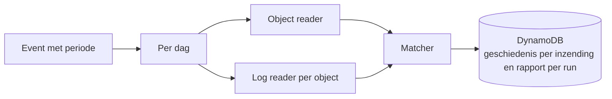

# Processing check

Een Lambda die voor een periode controleert of de inzendingen verwerkt zijn. Per dag haalt hij de Object-versies op met de
[object reader](../object-reader/README.md) en per object de logs met de [submission log reader](../submission-log-reader/README.md). De
[matcher](../matcher/README.md) bepaalt per versie de uitkomst. De uitkomsten komen per inzending in DynamoDB, met per run een rapport. De
check kijkt alleen: hij verandert niets aan Objects en start niets opnieuw.



## Aanroepen

Handmatig vanuit de Lambda-console, met een test-event. De functienaam staat in de outputs van de stack. Beide dagen tellen mee, in
Amsterdamse tijd:

```json
{ "firstDay": "2026-11-16", "lastDay": "2026-11-18" }
```

Een leeg event controleert gisteren. Met maar één dag, een datum die niet bestaat of een eerste dag na de laatste geeft de Lambda een fout en
doet hij niets. Het antwoord is het rapport van de run; de details staan in DynamoDB.

## Wat een run doet

De run maakt eerst zijn rapport aan met status RUNNING en gaat dan de dagen na elkaar af. Per dag haalt hij de versies op, leest hij per object
de logs van het begin van die dag tot nu (drie objecten tegelijk), laat hij de matcher de uitkomsten bepalen en werkt hij de
geschiedenis van elke inzending bij.
Aan het eind krijgt het rapport de totalen. Mislukt dag 3, dan blijven dag 1 en 2 gewoon staan.

Een dag is COMPLETE als de controle helemaal gedaan en opgeslagen is. Dat zegt niet dat alles goed verwerkt is. Een dag is INCOMPLETE als de
Objects API faalde (OBJECTS_API_FAILED, er staat niets van die dag), als de logs van een of meer objecten niet gelezen konden worden
(LOGS_NOT_READ, die versies zijn UNCERTAIN) of als de Lambda-tijd op was (OUT_OF_TIME, alleen de objecten die al klaar waren staan er). Een run
is COMPLETE als al zijn dagen dat zijn. Faalt het opslaan zelf, dan faalt de Lambda en blijft het rapport op RUNNING; na 15 minuten geldt het
als INCOMPLETE.

## Resultaten

Elke inzending heeft één geschiedenis met alle versies die ooit gecontroleerd zijn, over de dagen heen. Een ESF-taak die maandag open was en
woensdag afgerond, staat dus in één geschiedenis. De uitkomst van de inzending is de slechtste van zijn versies, en de geschiedenis onthoudt
wanneer er voor het eerst
een probleem was en wanneer dat opgelost is.

Elke aanroep is een run met een eigen rapport: per dag de status, de totalen per objecttype en de inzendingen die niet goed verwerkt zijn. De
rapporten staan gesorteerd op starttijd, dus de laatste runs of de runs van een maand haal je op met één query, nieuwste eerst. Een oud
rapport wordt nooit overschreven: het is wat die run vond.

Wat er precies in de tabel staat, staat in [store](store/README.md).

## Opnieuw controleren

Roep de Lambda opnieuw aan met dezelfde dag. Dat geeft een nieuwe run met een eigen rapport en de geschiedenis van de inzendingen wordt bijgewerkt. Een Step
Function die eerst nog bezig was en nu klaar is, gaat van IN_PROGRESS naar PROCESSED. Een dag die minder dan een uur geleden eindigde, geeft
voor ontbrekende notificaties UNCERTAIN, omdat de logs de dag dan nog niet helemaal dekken.

## Logging

Zo volg je een run in de log. Op info: de start van de run, per dag het begin, hoeveel versies de Objects API gaf, het begin van de log-reads
met het aantal objecten, elke 25 objecten de voortgang, het einde van de log-reads, het opslaan, en het einde van de dag met de aantallen en de
duur. Aan het eind van de run het rapport. Een mislukte log-read is een warn met de objectUuid en de fout, en als de tijd op is, staat er een
warn met hoeveel objecten niet meer gecontroleerd zijn. Op debug (zo staat acceptance) komt per object de log-read erbij en per versie die
niet PROCESSED of IGNORED is de uitkomst en de reden. Met diagnostics aan komen de kosten erbij. Logniveau en diagnostics staan per omgeving in
src/Configuration.ts.

## Code

Begin bij ProcessingCheck.ts: de run en de controle per dag. In historyAfterCheckingDay.ts staat hoe de geschiedenis van een inzending verandert na de controle van een dag. De map report bouwt het rapport. De
repository in [store](store/README.md) leest en schrijft beide. De tests in test/samples zijn per scenario een hele run, met DynamoDB en de
readers nagebootst.

## Beperkingen

Een lange periode past niet altijd in één aanroep: per object zijn het twee CloudWatch-queries en een drukke dag duurt al minuten. Kies dan een
kortere periode. Een herstel met een nieuwe execution, vanuit de console of de resubmit-lambda, ziet de matcher niet; zo'n inzending blijft
PROBLEM. Een redrive ziet hij wel. Of de ESB een afgeronde ESF-taak daarna verwerkt heeft, wordt nog niet gecontroleerd. De check start zichzelf
nog niet elke nacht; dat komt later met een EventBridge-regel.
