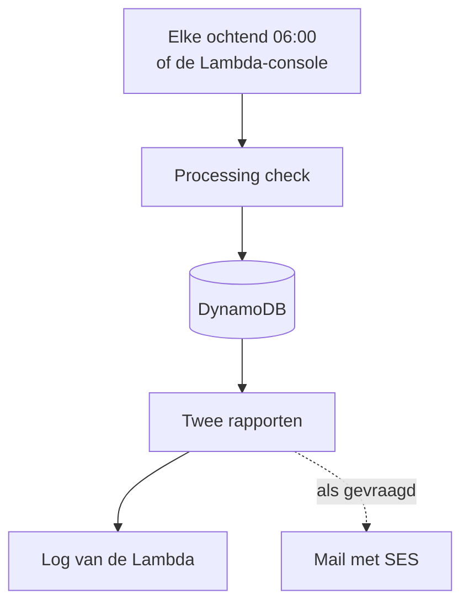

# Rapporten

Na elke run maakt de processing check twee rapporten als platte tekst: een voor de gewone inzendingen en een voor de ESF-taken. ESF heeft een
eigen groep functioneel beheerders en andere regels, daarom een eigen rapport; een ESF-taak telt niet mee in het gewone rapport. Beide rapporten
komen altijd in de log van de Lambda. Mailen gebeurt alleen als het event of de dagelijkse run erom vraagt. In de log en in de mail staat
precies dezelfde tekst, dus je kunt een rapport vanuit de console bekijken zonder te mailen.



## Elke ochtend

Om 06:00 Amsterdamse tijd, ook in de zomertijd, start EventBridge Scheduler de Lambda voor gisteren. Of dat gebeurt en welke rapporten dan
gemaild worden, staat per omgeving in src/Configuration.ts:

```ts
submissionProcessingMonitor: {
  diagnostics: true,
  dailyCheck: { emailSubmissionReport: true, emailEsfReport: false },
},
```

Zonder dailyCheck draait er 's nachts niets. Mailen kan alleen bij de dagelijkse run, dus een tegenstrijdige instelling bestaat niet. Mislukt
een run, dan probeert niemand hem opnieuw: een mailfout mag niet de hele controle nog een keer laten draaien. Het alarm op de Lambda laat zien
dat het misging.

## Met de hand

Vanuit de Lambda-console, zoals in de [processing check](../README.md) beschreven, met de twee mailopties erbij. Zonder mailopties wordt er niets
gemaild; dat werkt ook als de ontvangers nog niet ingevuld zijn. Een handmatige run mag mailen, ook als de dagelijkse run uit staat.

```json
{ "firstDay": "2026-11-16", "lastDay": "2026-11-18", "emailSubmissionReport": true, "emailEsfReport": false }
```

## Waar de gegevens vandaan komen

Alles komt uit de tabel. Het rapport van de run geeft de periode, per dag de status en de totalen per objecttype. Voor elke
inzending in notOkObjectUuids haalt de Lambda de geschiedenis op; daaruit komen de versies uit de periode die niet PROCESSED of IGNORED zijn, met
datum, index, uitkomst, reden, OF-nummer en formuliernaam. Er gaat niets opnieuw naar de Objects API of CloudWatch. Wat er in de tabel staat, staat
in [store](../store/README.md).

Bij ESF zijn de uitkomsten in de totalen alleen die van de afgeronde versies: open, verwerkt en gesloten zijn IGNORED. Succesvol afgeleverd
betekent dat de Step Function slaagde en het bericht op de ESB-queue zette. Of de ESB het daarna verwerkte, ziet de monitor niet.

## Het gewone rapport

Alle objecttypes behalve esfTaak, met de namen zoals ze uit de Objects API komen. Bovenaan de totalen, dan per objecttype, dan een blok per
uitkomst die aandacht vraagt. Een leeg blok valt weg. Bij elke versie staan de datum, het objecttype, het formulier, het OF-nummer, de uuid en
de versie, met Onbekend als iets niet bekend is. De kop van een afwijking is de reden van de matcher, zoals EXECUTION_FAILED; heeft de uitkomst
geen reden (nog in verwerking, na een redrive), dan de uitkomst zelf. De betekenis van de codes staat in de [matcher](../../matcher/README.md). Onder
de kop van een blok staat eerst het aantal per code, zodat je bij een storing meteen ziet of het één oorzaak is. De afwijkingen staan op datum,
dan op uuid en versie.

```text
Onderwerp: Open Forms - Dagrapport 22-11-2026 - Productie

OPEN FORMS - DAGOVERZICHT

Datum: 22 november 2026
Omgeving: Productie
Controle: Volledig uitgevoerd

Unieke inzendingen: 290
Geregistreerde objectversies: 295

- Succesvol verwerkt: 282
- Succesvol na redrive: 1
- Bewust niet verwerkt: 7
- Mislukt: 2
- Nog in verwerking: 1
- Onzeker: 2

INZENDINGEN PER OBJECTTYPE

SociaalDomein: 35 inzendingen, 35 versies
Submission: 180 inzendingen, 185 versies
TribeVerzoek: 45 inzendingen, 45 versies
VIPJZ: 30 inzendingen, 30 versies


--------------------------------------------------
PROBLEMEN (2)
--------------------------------------------------

EXECUTION_FAILED: 1, OBJECT_FETCH_FAILED: 1

1. EXECUTION_FAILED

   Datum: 22 november 2026
   Objecttype: Submission
   Formulier: Bingo melden
   OF-nummer: OF-9DNFG3
   Object-UUID: 3f6c2a9e-0b1d-4c55-9a37-2d8e5f1b7c40
   Versie: 1


2. OBJECT_FETCH_FAILED

   Datum: 22 november 2026
   Objecttype: VIPJZ
   Formulier: Onbekend
   OF-nummer: Onbekend
   Object-UUID: 8c42b9e0-a351-46d8-b284-a30f0f4e8261
   Versie: 2


--------------------------------------------------
NOG IN VERWERKING (1)
--------------------------------------------------

IN_PROGRESS: 1

1. IN_PROGRESS

   Datum: 22 november 2026
   Objecttype: SociaalDomein
   Formulier: Aanvraag bijzondere bijstand
   OF-nummer: OF-8KDR21
   Object-UUID: 5a7196e2-0f42-4835-9db1-f126d987da36
   Versie: 1


--------------------------------------------------
ONZEKER (2)
--------------------------------------------------

EXECUTION_EVENTS_NOT_FOUND: 1, TRACE_FITS_MULTIPLE_VERSIONS: 1

1. EXECUTION_EVENTS_NOT_FOUND

   Datum: 22 november 2026
   Objecttype: Submission
   Formulier: Evenement melden
   OF-nummer: OF-4ABC82
   Object-UUID: 76d1a984-3a6f-479c-b328-e4f8123d0957
   Versie: 1


2. TRACE_FITS_MULTIPLE_VERSIONS

   Datum: 22 november 2026
   Objecttype: TribeVerzoek
   Formulier: Onbekend
   OF-nummer: Onbekend
   Object-UUID: b21a70e6-92c8-4bb8-96c7-e93571d2a482
   Versie: 2


--------------------------------------------------
SUCCESVOL NA REDRIVE (1)
--------------------------------------------------

PROCESSED_AFTER_REDRIVE: 1

1. PROCESSED_AFTER_REDRIVE

   Datum: 22 november 2026
   Objecttype: VIPJZ
   Formulier: Vergunningaanvraag
   OF-nummer: OF-6XYZ34
   Object-UUID: c819e640-b712-475f-9c3a-a142e850ea73
   Versie: 1


--------------------------------------------------
TOELICHTING
--------------------------------------------------

De aantallen betreffen objectversies die in de gecontroleerde periode zijn geregistreerd. Eén inzending kan meerdere versies hebben.

Dit rapport bevat geen ESF-taken. Hiervoor wordt een afzonderlijk rapport opgesteld.

--------------------------------------------------
Automatisch gegenereerd door Open Forms Monitoring.
```

## Het ESF-rapport

Dezelfde opzet, met de aantallen per status en de aflevering van de afgeronde versies aan de ESB-queue. Succesvol afgeleverd zijn de afgeronde
versies waarvan de Step Function slaagde, ook na een redrive; die staan daarnaast apart onder SUCCESVOL NA REDRIVE. Bij een versie staat de
ESF-status in plaats van het objecttype en het formulier, die zijn bij ESF altijd hetzelfde. Een status die de monitor niet kent, staat er met
zijn eigen naam, niet bij een van de vier; bij de aflevering telt zo'n versie als Onzeker (UNKNOWN_ESF_STATUS).

```text
Onderwerp: ESF - Dagrapport 22-11-2026 - Productie

ESF - DAGOVERZICHT

Datum: 22 november 2026
Omgeving: Productie
Controle: Volledig uitgevoerd

Unieke ESF-taken: 26
Geregistreerde objectversies: 33

ESF-STATUSSEN

- Open: 20
- Afgerond: 8
- Verwerkt: 4
- Gesloten: 1

AFLEVERING AAN ESB (STATUS 'AFGEROND')

- Succesvol afgeleverd: 6
- Aflevering mislukt: 2
- Nog in verwerking: 0
- Onzeker: 0


--------------------------------------------------
PROBLEMEN (2)
--------------------------------------------------

EXECUTION_FAILED: 1, EXECUTION_START_FAILED: 1

1. EXECUTION_FAILED

   Datum: 22 november 2026
   OF-nummer: OF-7ABC12
   Object-UUID: 7d58f80c-6d17-41c0-8b85-fd00418ea821
   Versie: 3
   ESF-status: afgerond


2. EXECUTION_START_FAILED

   Datum: 22 november 2026
   OF-nummer: Onbekend
   Object-UUID: 91f719f6-0c6f-4b19-bad6-bc5d6959e532
   Versie: 2
   ESF-status: afgerond


--------------------------------------------------
TOELICHTING
--------------------------------------------------

De belangrijkste controle betreft ESF-taken met de status 'afgerond'.

Alleen ESF-taken met status 'afgerond' moeten via AWS Step Functions worden afgeleverd aan de ESB-queue.

De statussen 'open', 'verwerkt' en 'gesloten' worden niet doorgestuurd naar de ESB.

Een succesvolle Step Functions-execution betekent dat het bericht aan de ESB-queue is afgeleverd.
Dit betekent niet dat het bericht vervolgens inhoudelijk door ESB is verwerkt.

De ESF-statusaantallen betreffen geregistreerde objectversies in de gecontroleerde periode, niet noodzakelijk nieuw aangemaakte ESF-taken.

--------------------------------------------------
Automatisch gegenereerd door Open Forms Monitoring.
```

## Meer dagen

Een run over meer dagen geeft één rapport per groep, met de totalen en alle afwijkingen van de hele periode bovenaan en geen uitsplitsing per
dag. Een inzending die op meer dagen een versie heeft, telt één keer als unieke inzending. In het onderwerp en de kop staat de periode:

```text
Onderwerp: Open Forms - Rapport 01-11-2026 t/m 03-11-2026 - Productie

OPEN FORMS - OVERZICHT

Periode: 1 november 2026 t/m 3 november 2026
```

## Onvolledige controle

Is een dag niet helemaal gecontroleerd, dan begint het rapport met een waarschuwing en staan de dagen die niet volledig zijn erbij, met de
reden. De aantallen zijn dan alleen wat er wel gecontroleerd is. Faalde de Objects API, dan is er geen nulrapport maar alleen de waarschuwing.

```text
LET OP: CONTROLE ONVOLLEDIG

Niet alle inzendingen konden worden gecontroleerd.
De onderstaande aantallen betreffen uitsluitend de beschikbare resultaten en kunnen onvolledig zijn.

2 november 2026: LOGS_NOT_READ
3 november 2026: OUT_OF_TIME
```

Een complete controle zonder inzendingen geeft gewoon een rapport met nullen. Een gemaild rapport gaat elke dag, ook als alles goed ging.

## In de log

Per rapport logt de Lambda eerst Report started met de runId en het type (submissions of esf), dan de tekst, en daarna Report finished. Zo zie
je ook dat hij aan een rapport begon als het daarna misging. Een groot rapport komt in delen, elk met het deelnummer en het aantal delen, zodat er
niets afgekapt wordt. In de console vind je alles van een run met een filter op de runId. Daarna een regel per mail: gevraagd of niet, verstuurd
met de MessageId van SES, of de fout.

## Mail

De mail gaat met SES, zoals de mail van de internal notification lambda, vanaf submission-processing-monitor@ op het domein van het account. De
ontvangers staan per omgeving in twee SSM-parameters, komma-gescheiden:

```text
/open-forms/submission-processing-monitor/submission-report-recipients   beheer1@example.nl,beheer2@example.nl
/open-forms/submission-processing-monitor/esf-report-recipients          esf-beheer@example.nl
```

De Lambda leest ze alleen als er gemaild wordt. Is een parameter niet ingevuld of staat er geen geldig adres in, dan is dat een fout, net als een
fout van SES. Zijn beide rapporten gevraagd, dan probeert de Lambda ze allebei en faalt hij daarna. De resultaten in DynamoDB en de rapporten in de
log blijven staan. Opnieuw mailen is de Lambda opnieuw starten met de mailopties; dat is een nieuwe controle.

## Beperkingen

Stopt de Lambda door een harde timeout of een crash voordat de rapporten gemaakt zijn, dan is er geen rapport en geen mail; het alarm gaat af.
Na een mislukte log-read houdt de geschiedenis van een inzending het eerdere oordeel vast, dus de lijst kan dan iets anders zijn dan de
totalen; de dag staat dan op onvolledig. Een heel groot rapport wordt niet gesplitst of ingekort.
